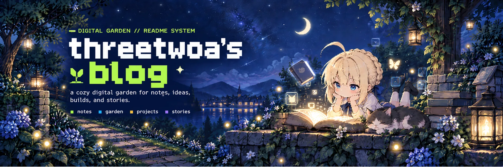
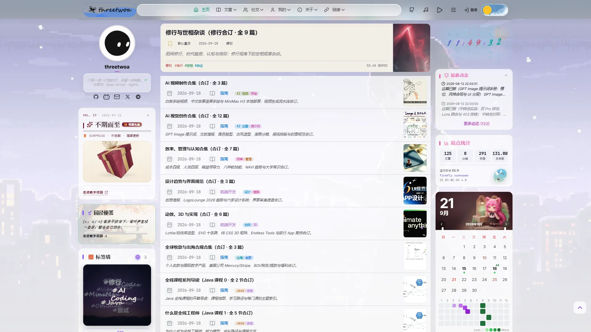
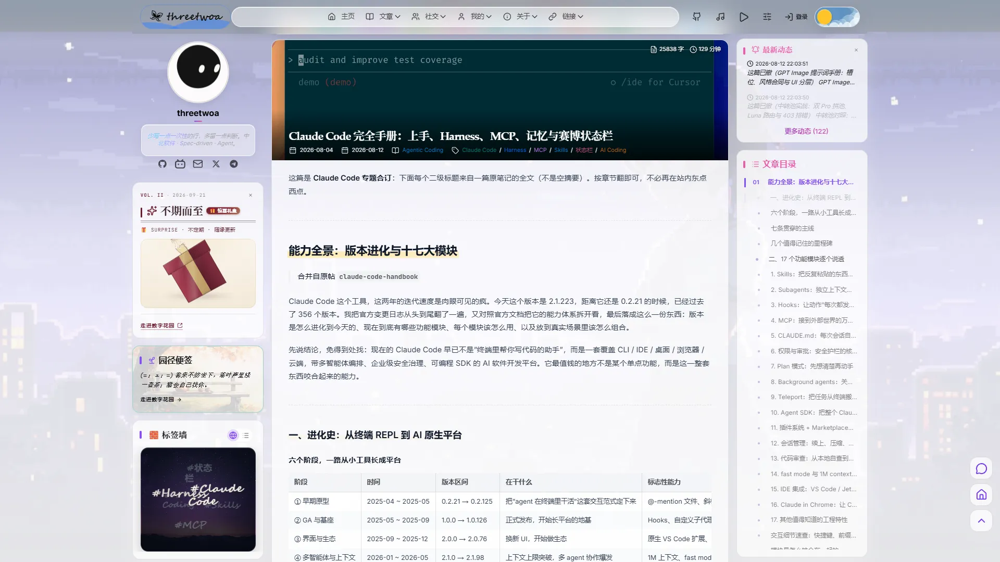
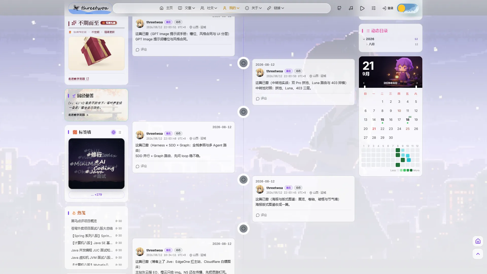
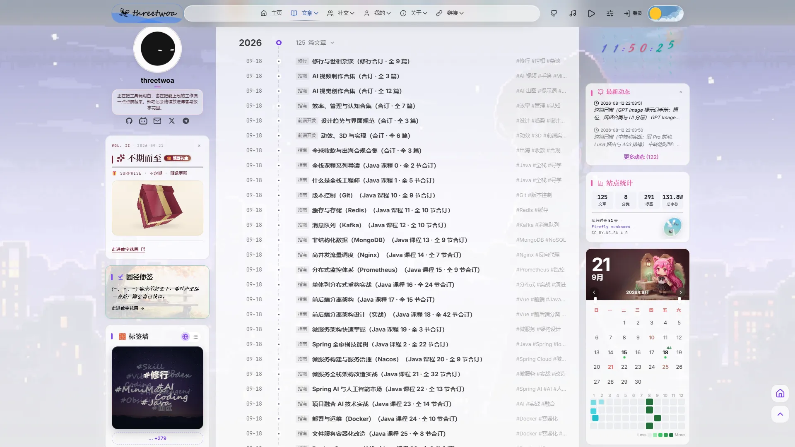
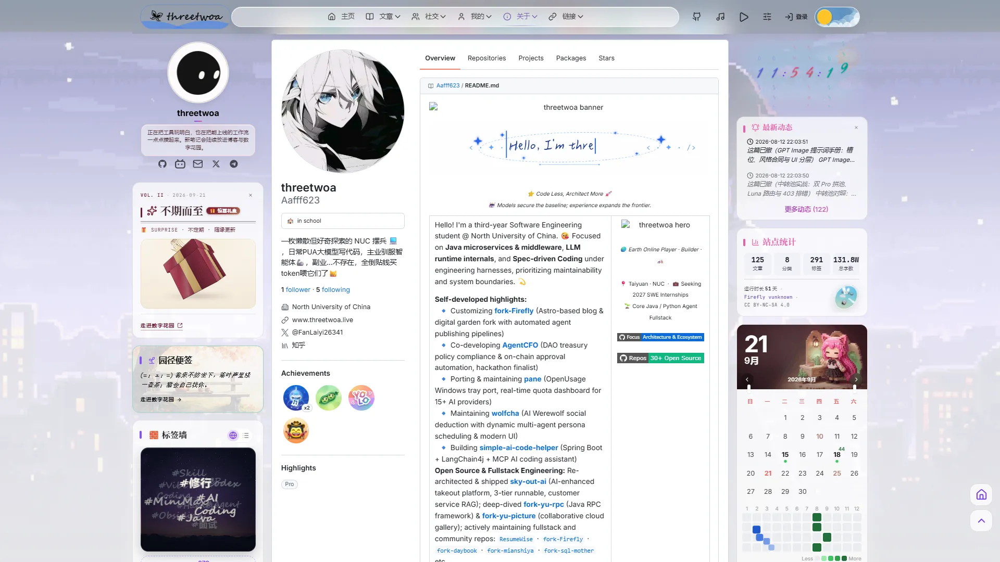
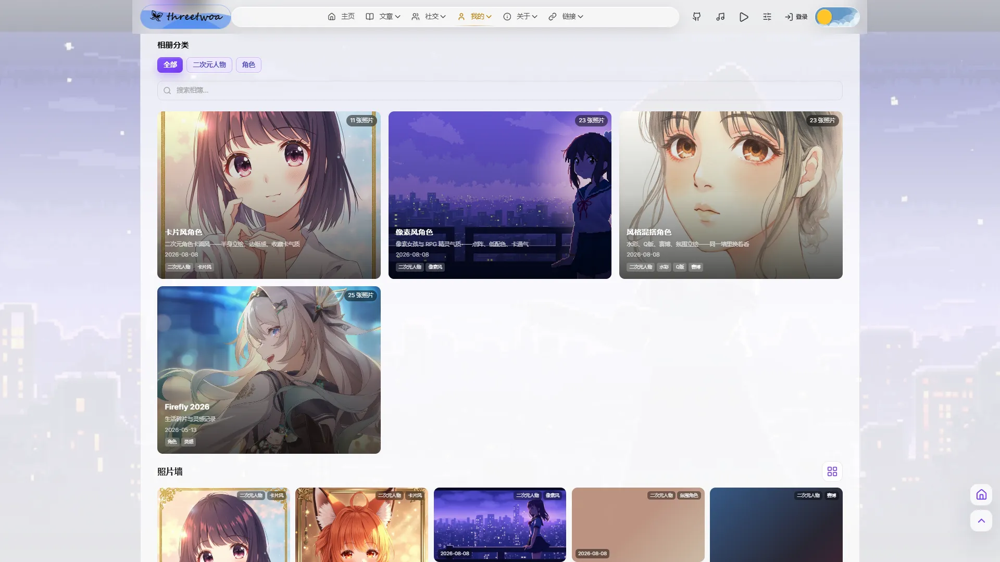
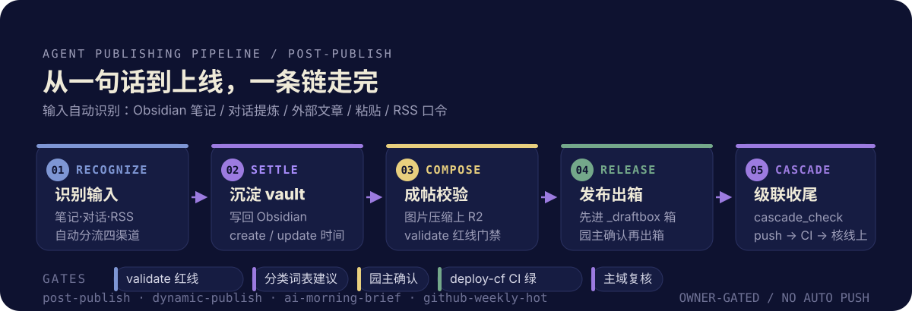
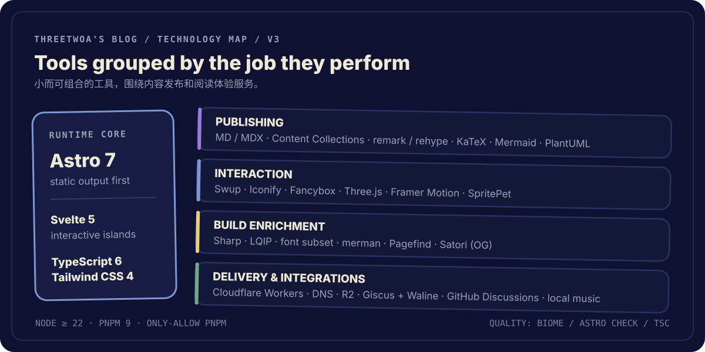
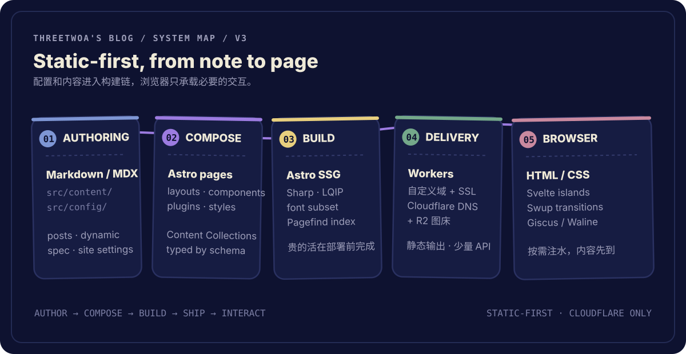

<p align="center">
  
</p>

<p align="center">
  <a href="https://www.threetwoa.live"></a>
  <a href="https://github.com/Aafff623/fork-Firefly/releases"></a>
  <a href="https://github.com/Aafff623/fork-Firefly/blob/master/LICENSE"></a>
  <a href="https://github.com/Aafff623/fork-Firefly/commits/master"></a>
  
  
  
  
</p>

<p align="center">
  <a href="#showcase">Showcase</a>
  · <a href="#features">Features</a>
  · <a href="#agent-发文流水线">Agent Pipeline</a>
  · <a href="#tech-stack">Tech Stack</a>
  · <a href="#architecture">Architecture</a>
  · <a href="#performance">Performance</a>
  · <a href="#quick-start">Quick Start</a>
  · <a href="#deploy">Deploy</a>
  · <a href="https://www.threetwoa.live">Live</a>
</p>

---

## 这是什么

一个 Astro 个人博客：正文在 Markdown，行为在 `src/config`，页面静态生成、Svelte 岛屿按需注水。文章、短动态、AI 早报、GitHub 热榜都由 Agent 流水线打理，园主只确认与拍板。

> [!TIP]
> 本仓源自 [CuteLeaf/Firefly](https://github.com/CuteLeaf/Firefly)（血脉可追至 [saicaca/fuwari](https://github.com/saicaca/fuwari)），已脱离 fork network 独立演进：保留上游的内容与页面能力，叠加本仓品牌配置、自研组件、交互与多 Agent 交付约定。主入口：<https://www.threetwoa.live>。

| 支柱 | 是什么 |
| --- | --- |
| **配置驱动** | 改站先改 `src/config`——品牌、侧栏、壁纸、评论、桌宠、音乐全是开关，不动布局内核 |
| **静态优先 · 岛屿交互** | Astro 7 SSG 全量预渲染；Svelte islands + Swup 只给必要交互，首屏不被 JS 门控 |
| **Agent 全链发文** | `post-publish` 一条链：识别输入 → 沉淀 Obsidian vault → 成帖校验 → 草稿箱 → 级联收尾 |
| **Cloudflare 单平台** | Workers 托管 + DNS + R2 图床一家承接（ADR-0009）；push 即部署，CI 绿再核线上 |

## Showcase

真实界面优先：截图全部取自线上真机（Playwright 脚本 [scripts/capture-readme-showcase.py](scripts/capture-readme-showcase.py) 可一键重截；1920×1080、light 主题、隐藏桌宠与 toast，滚动到内容区取景）。推荐逛站路径：首页 → 文章 → Dynamic → Timeline → About → Gallery。

<table>
  <tr>
    <td width="33%" valign="top" align="center">
      <a href="assets/images/readme/showcase-home.webp"></a>
      <br><strong>Home</strong><br>
      <sub>文章卡片 · 双侧栏 · 壁纸横幅 · 分类条</sub><br>
      <a href="https://www.threetwoa.live/">Open</a>
    </td>
    <td width="33%" valign="top" align="center">
      <a href="assets/images/readme/showcase-post.webp"></a>
      <br><strong>Post</strong><br>
      <sub>Index-First TOC · 封面 · Markdown 扩展 · 公告礼盒</sub><br>
      <a href="https://www.threetwoa.live/">Open</a>
    </td>
    <td width="33%" valign="top" align="center">
      <a href="assets/images/readme/showcase-dynamic.webp"></a>
      <br><strong>Dynamic</strong><br>
      <sub>朋友圈式短动态 · 本地 content 时间线 · 一键发布</sub><br>
      <a href="https://www.threetwoa.live/dynamic/">Open</a>
    </td>
  </tr>
  <tr>
    <td width="33%" valign="top" align="center">
      <a href="assets/images/readme/showcase-timeline.webp"></a>
      <br><strong>Timeline</strong><br>
      <sub>按年折叠 · 行列表 · 内容索引</sub><br>
      <a href="https://www.threetwoa.live/timeline/">Open</a>
    </td>
    <td width="33%" valign="top" align="center">
      <a href="assets/images/readme/showcase-about.webp"></a>
      <br><strong>About</strong><br>
      <sub>GitHub profile 克隆 · 置顶仓库 · profile README</sub><br>
      <a href="https://www.threetwoa.live/about/">Open</a>
    </td>
    <td width="33%" valign="top" align="center">
      <a href="assets/images/readme/showcase-gallery.webp"></a>
      <br><strong>Gallery</strong><br>
      <sub>作品集手风琴 · 无限画布双模式</sub><br>
      <a href="https://www.threetwoa.live/gallery/">Open</a>
    </td>
  </tr>
</table>

## Features

能力按「发布 → 阅读 → 个人页 → 集成」分层；下表是本仓现行能力（不是上游全部开关列表），全量对照见折叠详表。

| 层 | 你能做什么 | 主要入口 |
| --- | --- | --- |
| Publishing | MD/MDX 成帖；草稿 / 置顶 / 密码文；RSS · Sitemap · OG · Pagefind | `src/content/` · `astro.config.mjs` |
| Reading | list / grid / waterfall；Index-First TOC；亮暗色 / 色相 / 壁纸 | `PostPage.astro` · `displaySettingsConfig.ts` |
| Performance | Swup 泄漏治理 · 图片按需物化 · 移动端组件裁剪 · 首屏 LCP 渲染门控 | `src/lib/page-lifecycle.ts` |
| Ask | `/ask` 自研聊天岛（mode: page/widget）、站内检索、SSE、桌宠 LiveChat | `src/components/ask/` · `src/pages/api/ask.ts` |
| Personal | Dynamic 时间线、摘星录 / 藏经阁、GitHub Discussions、Gallery、About / Friends / Guestbook | `src/pages/` · `src/content/spec/` |
| Widgets | 热力图、日历、公告礼盒、园径便签、标签墙、站点统计、桌宠 | `src/components/widget/` |
| Delivery | Cloudflare Workers 主入口、R2 外置大图 | `wrangler.jsonc` · `astro.config.mjs` |

<details>
<summary><b>Features × Integrations 全量对照表</b></summary>

### 能力详表（Area · Capability · Entry）

| Area | Capability | Included | Main entry |
| --- | --- | --- | --- |
| Publishing | Content model | `posts`、`dynamic`、`spec` 三类 Content Collections | `src/content/` · `src/content.config.ts` |
| Publishing | Authoring | Markdown / MDX、frontmatter、草稿、置顶、密码文章、文章关联 | `src/content/` · `src/plugins/` |
| Publishing | Build output | RSS、Sitemap、OpenGraph、阅读时间、字数、Pagefind 索引 | `astro.config.mjs` · `scripts/` |
| Publishing | Rich content | KaTeX、Mermaid（merman 静态 SVG）、PlantUML、Wiki Link、代码组、directive | `src/plugins/` |
| Reading | List system | list、grid、waterfall；Featured、标签和分类入口 | `src/components/layout/` |
| Reading | Article navigation | Index-First TOC、相关文章、文章导航、标签聚焦 | `src/components/layout/PostPage.astro` |
| Reading | Display controls | 亮暗色、time 模式、色相、壁纸模式、卡片表现 | `src/config/displaySettingsConfig.ts` |
| Reading | Interaction model | Swup 页面过渡与 Svelte islands 按需注水 | `src/components/` · `src/layouts/` |
| Personal | Dynamic | 碎碎念时间线，可接本地内容或 Memos | `src/pages/dynamic/index.astro` |
| Personal | Achievements | 摘星录徽章墙（PROD 占位，DEV 完整星墙） | `src/config/achievementsConfig.ts` |
| Personal | Nav sites | 藏经阁站点导航（PROD 占位，DEV 完整目录） | `src/pages/nav/` |
| Personal | About | GitHub profile 克隆 + 可选 `about-site.md` | `GitHubProfile.astro` · `src/lib/github-profile.ts` |
| Personal | Gallery | 作品集手风琴与 Three.js 无限画布双模式 | `src/pages/gallery/` |
| Personal | Extended pages | Community、Friends、Guestbook、Anime 等独立页面 | `src/pages/` · `src/content/spec/` |
| Personal | Widgets | 热力图、日历、公告礼盒、园径便签、标签墙、统计、桌宠 | `src/components/widget/` |
| Ask | AskChat | 自研问答岛（已去 HeroUI）、站内检索、SSE、桌宠 LiveChat；PROD 占位、DEV 完整 | `src/components/ask/` · `src/pages/api/ask.ts` |

### 集成矩阵（现行 vs 备选）

| 域 | 现行 | 备选 / 备注 | 配置 |
| --- | --- | --- | --- |
| 评论 | **Giscus**（文章）+ **Waline**（Dynamic 内联回复，qq/weibo/bilibili/bmoji 表情 + Giphy） | Twikoo / Artalk / Disqus 槽位保留 | `commentConfig.ts` · [ADR-0006](docs/adr/0006-giscus-with-waline-dynamic-channel.md) |
| 社区 | **GitHub Discussions** 分区与身份体系 | 独立论坛留作后续 | `communityConfig.ts` · `/community/` |
| 桌宠 | **SpritePet**（双 DeepSeek 皮，访客可换皮） | Live2D / Spine（三者互斥） | `petConfig.ts` · `pioConfig.ts` |
| 音乐 | **local** 自托管曲库 | Meting API 备源 | `musicConfig.ts` · [ADR-0002](docs/adr/0002-local-music-default.md) |
| 图标 | Iconify + **Lucide** 为主 | fa7 / simple-icons / mdi / mingcute / material-symbols | `astro.config.mjs` |
| 动态源 | 本地 `content/dynamic` | 可选 Memos API | `dynamicConfig.ts` |
| 图示 / 灯箱 | Mermaid 经 **merman** 构建期出 SVG；Fancybox 灯箱 | PlantUML · panzoom | `@mermanjs/web` · `@fancyapps/ui` |
| 媒体 | 评论大图优先 Cloudflare R2（服务端代理，绕过 128KB Base64） | COS 兼容链保留；未配存储变量则上传不可用 | `/api/comment-image` · `.env.example` |
| 认证 | 园主登录走 Supabase Auth（GitHub / Google / 邮箱） | — | [ADR-0008](docs/adr/0008-supabase-auth.md) |
| 分析 | 槽位就绪（GA / Clarity / Umami / 51la） | ID 多为空，按需填 | `analyticsConfig.ts` |

</details>

## Agent 发文流水线

本仓同时是 Cursor / Claude Code / Codex 等多 Agent 并行工作区：壁纸、音乐、配图、发文各有人负责，园主只过门禁。其中最长的一条链是发文——从一句话到上线走完五段：

<p align="center">
  
</p>

| 链路 | 一句话 | 关键门禁 |
| --- | --- | --- |
| 发文 | `post-publish` 一条链；短动态 `dynamic-publish`、早报 `ai-morning-brief`、热榜 `github-weekly-hot` | 草稿先落 `_draftbox/`，出箱需园主确认 |
| 功能 | idea → Issue → PRD(draft) → 园主批准 → handoff → 实施 | 未批准不写大规模功能代码 |
| 交付 | 本地预览 → check/build → 园主确认 → push → deploy-cf CI 绿 → 主域复核 | 未本地验收不得 push；未核主域不宣称完成 |

<details>
<summary><b>协作治理文档索引（访客可跳过）</b></summary>

| 入口 | 用途 |
| --- | --- |
| [AGENTS.md](AGENTS.md) | 工程流程入口、修改边界、验证与交付规则（协作者宪法） |
| [CONTEXT.md](CONTEXT.md) | 产品定位、技术事实、术语和仓库边界 |
| [docs/agents/](docs/agents/) | Matt tracker 适配（`issue-tracker.md` · `domain.md` · `triage-labels.md`）+ 内容流水线（`workflow.md`）· 语气（`voice.md`） |
| [docs/adr/](docs/adr/) | 10 份架构决策记录（评论双通道、本地音乐、Supabase 认证、Cloudflare 单平台……） |
| [.scratch/](.scratch/) | 任务状态唯一归属：决策地图 / 决策票 / spec / 实现票 |

硬约束：只改任务相关行、不顺手重构；密钥不入库（不提交 `.env`、评论服务 token、私有 API key）；二次开发请保留 Firefly / Fuwari 的版权声明与 MIT 义务。

</details>

## Tech stack

图给整体印象，表负责事实；图若略旧，以本表与 `package.json` 为准。

<p align="center">
  
</p>

| Lane | Stack | Role |
| --- | --- | --- |
| Runtime core | Astro 7.1 · Svelte 5 · React 19（少量）· TypeScript 6 · Tailwind CSS 4 · pnpm 9 · Node ≥22 | 页面、岛屿、类型与样式 |
| Publishing | MD / MDX · Content Collections · remark / rehype · Expressive Code | 写作契约与正文增强 |
| Fonts | Inter（全局）· Zen Maru（横幅）· JetBrains Mono（代码）· GreatVibes（本地子集） | 品牌与可读性 |
| Interaction | Swup · Iconify（Lucide 主）· Fancybox · Three.js（Gallery）· Framer Motion | 过渡、图标、灯箱、画廊 |
| Build enrichment | Sharp · LQIP · font subset · **merman** · Pagefind · Satori（OG） | 构建期把贵活做完 |
| Delivery | Cloudflare Workers（`@astrojs/cloudflare`）· Cloudflare DNS / R2 | 静态出站 + 少量 API + 外置大图 |
| Site integrations | Giscus · GitHub Discussions · Waline（Dynamic）· SpritePet · local music · analytics 槽位 | 配置门控，按路由延迟加载 |
| Quality | Biome · `astro check` · tsc · only-allow pnpm | 格式、类型与包管理纪律 |
| Agent tooling | post-publish · dynamic-publish · 早报/热榜 skills · gsap-* | 开发期工作流，非运行时依赖 |

## Architecture

把「常改」与「少动」分开：运营改配置和 Markdown；构建期做图片 / 字体 / Mermaid / 搜索索引；浏览器只拿必要的岛屿交互。

<p align="center">
  
</p>

| Layer | Responsibility | Primary surfaces |
| --- | --- | --- |
| Authoring | 配置、文案、Markdown / MDX | `src/config` · `src/content` |
| Composition | 页面、布局、组件、Markdown plugins | `src/pages` · `src/layouts` · `src/components` · `src/plugins` |
| Build | SSG、LQIP、字体子集、Mermaid SVG、Pagefind | `pnpm build` 串起 |
| Runtime | CDN + 轻量交互 + 少量 API | Cloudflare Workers · Swup · Svelte islands · Waline · SpritePet |

<details>
<summary><b>设计原则</b></summary>

1. **Config over layout** — 品牌、开关、壁纸、侧栏优先进 `src/config`。
2. **Static by default** — 默认静态出站；仅 API 与明确运行时需求才上 adapter。
3. **Islands, not SPA** — 按组件注水，不把整站做成客户端应用。
4. **Content collections** — `posts` / `dynamic` / `spec` 均经 schema 校验。
5. **Motion with intent** — 微交互优先 CSS；重动画保留 reduced-motion。
6. **Visual consistency** — 壳层中性灰、彩仅点缀（紫系邻近色只出现在链接、高亮、图标、竖条），默认色相 hue ≈ 290。
7. **Performance as a feature** — 不阉割视觉换性能；只优化加载策略与生命周期。

</details>

## Performance

性能专项已推进到 V10。**方法比单个跑分重要**：先用 LCP / CDP / 20-hop 探针确认瓶颈，再改加载策略、生命周期和移动端信息密度。下表为代表性结果，跨环境数字只作趋势判断，不伪装成严格 A/B。

| 指标 | 参考值 | 当前值 | 变化与口径 |
| --- | ---: | ---: | --- |
| 移动端 LCP | 3241 ms | 2221 ms | -31.5%；线上旧版 vs 本地当前版，趋势值 |
| 桌面 LCP | 1696 ms | 420 ms | -75.2%；环境不可比，仅作方向验证 |
| 移动端 DOM 节点 | 3597 | 3015 | -16.2% |
| 桌面 DOM 节点 | 3598 | ≈3200 | -11.1% |
| TagCloud reflow | 723 ms | 140 ms | -80.6% |
| 构建产物 dist | 571 MB | 185 MB | V4→V7（agents.astro glob 根治 + pio 出仓 + 孤儿 chunk 清零） |
| 每页内联脚本 | 162 KB | 49 KB | V4→V7；music 双脚本 defer、hero 大图懒换、页脚 CSS 异步 |
| Swup 软跳转事件 | — | 中位 291 ms | V8；20-hop 回归无重复 iframe / ID / Waline 泄漏 |
| CLS | 0.27（曾） | 0.01 | hero/音乐脚本 defer 引入的抖动已收敛 |

移动端不是等比缩小 PC：RepelText 字符、TagCloud CDN / 动画、Calendar 冗余请求和底部冗余侧栏都在小屏归零。核心治理包括 Swup 生命周期统一清理、图片按需物化、Pagefind 懒加载、内联脚本外置、首屏渲染门控、评论双通道按页面门控与 2 并发意图队列导航（V9）。

<details>
<summary><b>版本里程碑</b></summary>

- **V8**（2026-08-20 · [v1.4.0](https://github.com/Aafff623/fork-Firefly/releases/tag/v1.4.0)）：文章评论切回 Giscus + `/community/` Discussions 门户。
- **V9**（2026-08-21）：意图队列导航 + GitHub numeric-id 园主会话 + 本地编辑器。
- **V10**（2026-08-30 · [v1.5.0](https://github.com/Aafff623/fork-Firefly/releases/tag/v1.5.0)）：新增 Java 全栈课程文章 531 篇并修复误标草稿；本地构建文章页 589→703 全部生成；分支收敛为 `master` 单分支。

完整测试边界与 20-hop 回归：Wiki [Performance](https://github.com/Aafff623/fork-Firefly/wiki/Performance)。

</details>

## Quick start

**Requirements**：Node.js ≥ 22 · pnpm `9.14.4`（`preinstall` 强制 pnpm）。

```bash
git clone https://github.com/Aafff623/fork-Firefly.git
cd fork-Firefly
pnpm install
pnpm dev
```

打开 <http://127.0.0.1:4321>。要改成自己的站，按 [Configuration](#configuration) 从零部署清单推进。

| 命令 | 用途 |
| --- | --- |
| `pnpm dev` | 本地开发 |
| `pnpm check` · `pnpm type-check` | 诊断与类型 |
| `pnpm build` · `pnpm preview` | 生产构建与预览 |
| `pnpm new-post <slug>` | 新建文章骨架 |
| `pnpm new-d <一句话>` | 新建动态 |
| `python scripts/capture-readme-showcase.py` | 重截 Showcase（需先 `pnpm dev`；输出压成 WebP 后入库） |

## Configuration

从零部署按序推进：先跑通站点 → 填身份与内容 → 再开评论 / 动态源 / R2。配置优先于改布局内核。

<details>
<summary><b>展开：从零部署 9 步 + 配置文件地图</b></summary>

1. **环境**：Node ≥ 22 · pnpm 9.14.4（`node --version` · `pnpm --version`）。
2. **安装**：clone → `pnpm install`（npmmirror 404 时加 `--registry https://registry.npmjs.org`）。
3. **站点身份**：`siteConfig.ts`（站名、色相、语言、页面开关）、`profileConfig.ts`（头像、简介、联系方式）、`navBarConfig.ts`（导航与搜索）；语言 `const SITE_LANG = "zh_CN";`。
4. **显示与页面**：`sidebarConfig` · `backgroundWallpaper` · `displaySettingsConfig` · `galleryConfig`。
5. **内容目录**：

   ```text
   src/content/posts/      # 文章（MD / MDX）
   src/content/dynamic/    # 动态 / 碎碎念（可接 Memos）
   src/content/spec/       # About · Friends · Guestbook 等
   ```

   frontmatter 由 [src/content.config.ts](src/content.config.ts) 校验；生产默认隐藏 `draft: true`。
6. **集成**：需要密钥时复制 `.env.example` → `.env`（勿提交）。评论、桌宠、音乐、R2 见集成矩阵。
7. **本地验证**：`pnpm check` · `pnpm type-check` · `pnpm check:owner` · `pnpm build` · `pnpm preview`。
8. **交付链**：评论 / R2 / Ask 等变量在 Cloudflare Worker Secrets（wrangler secret）与本地 `.env.local` 补齐。
9. **上线复核**：主域首页 · 文章 · 搜索 · RSS · Sitemap · 评论 · R2 图片 · 移动端；push 后看 `deploy-cf.yml` CI。

#### 配置文件地图

| 你想改什么 | 文件 |
| --- | --- |
| 站点名、色相、页面开关、文章列表 | `src/config/siteConfig.ts` |
| 头像、简介、联系方式 | `src/config/profileConfig.ts` |
| 导航和搜索 | `src/config/navBarConfig.ts` |
| 双侧栏与 widget 顺序 | `src/config/sidebarConfig.ts` |
| 壁纸、透明度和背景模式 | `src/config/backgroundWallpaper.ts` |
| 亮暗色、布局和显示面板 | `src/config/displaySettingsConfig.ts` |
| 评论与社区 | `src/config/commentConfig.ts` · `communityConfig.ts` |
| 相册模式与元数据 | `src/config/galleryConfig.ts` |
| 公告、礼盒和日历封面 | `src/config/announcementConfig.ts` |
| 特效开关 | `src/config/effectsConfig.ts` |
| 音乐、桌宠、Live2D / Spine | `musicConfig.ts` · `petConfig.ts` · `pioConfig.ts` |
| 字体、代码块和 Markdown 扩展 | `fontConfig.ts` · `expressiveCodeConfig.ts` · `src/plugins/` |

配置经 [src/config/index.ts](src/config/index.ts) 统一导出，类型定义集中在 `src/types/`。

#### 样式基线

| 域 | 现行 |
| --- | --- |
| 主题 | time 模式（按时段自动亮暗）· hue 290 · 卡片边框开 |
| 字体 | 全局 Inter；横幅 Zen Maru；代码 JetBrains Mono |
| 代码主题 | `one-dark-pro` / `one-light` |
| 图标 | Iconify，UI 以 Lucide 为主 |
| README 配图 | `assets/images/readme/`（hero / banner / showcase / 架构与技术地图 SVG） |

</details>

## Deploy

生产托管收敛到 Cloudflare 一家（2026-09-19 起 Vercel / EdgeOne 均退役，见 [ADR-0009](docs/adr/0009-cloudflare-only-hosting.md)）：

| 平台 | 职责 | 入口 / 配置 | 验收信号 |
| --- | --- | --- | --- |
| Cloudflare Workers | Git `master` 自动构建（`deploy-cf.yml`）、SSR/API、自定义域 | [wrangler.jsonc](wrangler.jsonc) · `threetwoa.live` / `www.threetwoa.live` | CI `success`、主域 200 |
| Cloudflare R2 | `img.threetwoa.live` 图床 | R2 bucket `firefly-comment` | 对象 200、`cf-cache-status` |

主入口是 <https://www.threetwoa.live>。push 后部署由 `.github/workflows/deploy-cf.yml` 自动完成，本地 `pnpm build` 与 CI 同走 Cloudflare adapter。

## Acknowledgments

<p align="center">
  
</p>

- Theme: [CuteLeaf/Firefly](https://github.com/CuteLeaf/Firefly) · Original theme lineage: [saicaca/fuwari](https://github.com/saicaca/fuwari)
- Working style: [andrej-karpathy-skills](https://github.com/multica-ai/andrej-karpathy-skills)
- Author: [Aafff623](https://github.com/Aafff623) · [threetwoa's blog](https://www.threetwoa.live)
- License: [MIT](LICENSE)
